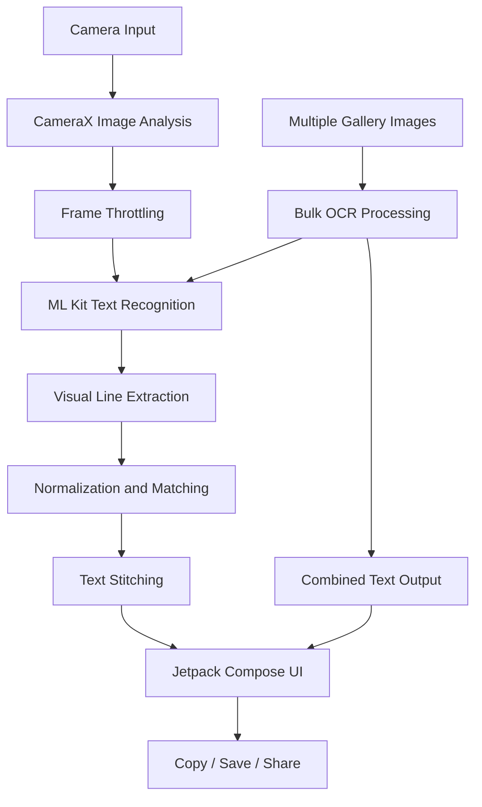

# LiveLens — Advanced Live Text & Code Scanner

<p align="center">
  
</p>

<p align="center">
  <b>Turn your camera into a real-time text and code scanner.</b>
  <br />
  Powered by Google ML Kit, CameraX and Jetpack Compose.
</p>

<p align="center">
  
  
  
  
  
</p>

---

## Overview

**LiveLens** is an Android application for real-time text and programming-code extraction using your device's camera. Point your camera at a laptop, monitor, book, or another phone to recognize visible text directly on your device.

It also supports **Bulk Image OCR**, allowing users to select multiple images, extract their text and combine the results into a single output.

Built using Google ML Kit, CameraX and Jetpack Compose, LiveLens combines on-device OCR, intelligent text processing and a full-screen floating glass interface.

## App Preview

<p align="center">
  
  
  
</p>

<p align="center">
  <i>Live Scanner · Extracted Text · Saved Snippets</i>
</p>

## Features

| Feature | Description |
|---|---|
| Real-time OCR | Continuously extract text through the camera |
| Code Recognition | Extract programming code, symbols and syntax |
| Smart Text Stitching | Detect overlapping content and prevent duplicate text while scrolling |
| Bulk Image OCR | Select multiple images and extract text in batches |
| Combined Text Output | Merge extracted content from multiple images |
| Custom Separators | Separate image results using configurable formats |
| OCR Settings | Configure batch size, processing speed and text cleanup |
| Autofocus & Zoom | Tap-to-focus, pinch-to-zoom and flashlight controls |
| Floating Glass UI | Translucent, resizable extraction panel |
| Saved Snippets | Save, copy, share and manage extracted content |

## Interface Design

### 1. Full-Screen Scanner

<p align="center">
  
</p>

- Full-screen camera preview.
- Floating camera and scanning controls.
- Tap-to-focus and pinch-to-zoom.
- Camera-based continuous OCR.

### 2. Floating Extraction Panel

<p align="center">
  
</p>

- Adjustable frosted-glass container.
- Expandable and collapsible panel.
- Monospace font for programming code.
- Internal scrolling for longer extracted content.
- Quick Copy, Save, Share and Saved Snippets actions.

### 3. Bulk Image OCR

Select multiple images from the gallery and extract their text using Google ML Kit.

<p align="center">
  
</p>

- Multi-image selection.
- Individual image preview and management.
- OCR processing with bounded concurrency.
- Combine extracted text into one editable output.
- Change separators without running OCR again.
- Copy the combined result.

**Available output separators:**

| Separator | Output |
|---|---|
| New line | Single line break |
| Empty line | Blank line between images |
| `___` | Three underscores |
| `----` | Four dashes |
| Image numbering | Image 1, Image 2, etc. |

### 4. OCR Settings & Export Customization

<p align="center">
  
  
</p>

LiveLens provides configurable OCR controls, including:

- Maximum Vote Cleanup.
- Adjustable OCR batch size.
- Fast Mode FPS.
- Document separators between bulk image results.

### 5. Saved Snippets

<p align="center">
  
</p>

- Persistent local snippet storage.
- Reverse chronological ordering.
- Line counts and timestamps.
- One-tap copy and share.
- Individual deletion and Clear All functionality.

## How It Works

<p align="center">
  
</p>

### OCR Processing Pipeline



### Processing Flow

1. **Camera Input:** CameraX continuously provides camera frames.
2. **Frame Analysis:** Image analysis processes frames using a keep-only-latest backpressure strategy.
3. **OCR Recognition:** Google ML Kit detects text directly from camera images.
4. **Text Processing:** Recognized text is traversed through its block, line and element hierarchy.
5. **Text Stitching:** Overlapping content is matched to prevent repeated text during scrolling.
6. **Bulk Processing:** Selected gallery images are processed independently and their results are combined.
7. **Output Rendering:** Jetpack Compose displays extracted content.
8. **User Actions:** Extracted content can be copied, saved or shared.

## Technology Stack

<p align="center">
  
</p>

| Technology | Purpose |
|---|---|
| Kotlin 2.2.x | Primary programming language |
| Jetpack Compose | Declarative UI |
| Material 3 | Modern Android design components |
| CameraX 1.5.0 | Camera preview and image analysis |
| Google ML Kit 16.0.1 | On-device text recognition |
| Kotlin Coroutines | Asynchronous processing |
| Accompanist Permissions 0.37.3 | Camera permission handling |
| Gradle Version Catalog | Centralized dependency management |

## Performance Optimizations

LiveLens includes optimizations designed to keep camera processing responsive and memory usage controlled.

### CameraX Frame Management

- `STRATEGY_KEEP_ONLY_LATEST` prevents unnecessary frame backlogs.
- `AtomicBoolean` prevents concurrent live OCR processing.
- Frame throttling controls OCR frequency.
- Camera image buffers are released after processing.
- A reusable ML Kit recognizer avoids repeated initialization.

### Image Processing

- Direct `InputImage.fromMediaImage()` conversion.
- Avoids intermediate Bitmap allocations.
- Full HD analysis target: `1920 × 1080`.
- Tap-to-focus and pinch-to-zoom for closer text capture.

### Code-Oriented Text Processing

- Traverses the ML Kit `TextBlock → Line → Element` hierarchy.
- Visual-line clustering and indentation reconstruction.
- Programming-symbol cleanup for common OCR recognition errors.
- Tail-anchored sequence matching for overlap detection.
- Upward camera-jitter suppression.
- Tentative boundary-line confirmation to handle blurry transitions.

### Bulk OCR Processing

- Bounded concurrent image processing using a semaphore.
- Maximum of 2 concurrent image-processing workers.
- Coroutine cancellation when images are removed or cleared.
- Background persistence operations using `Dispatchers.IO` and `Mutex`.

## Project Modernization

LiveLens was updated from an older Android project baseline to modern Android tooling and APIs.

| Component | Modernization |
|---|---|
| Kotlin | Updated to 2.2.x |
| Android Gradle Plugin | Updated to 9.1.x |
| Target SDK | 36 |
| CameraX | Updated to 1.5.0 |
| ML Kit | Updated to 16.0.1 |
| Compose | Migrated to Material 3 |
| Permissions | Updated Accompanist Permissions |
| Dependencies | Migrated to Gradle Version Catalog |

Unused template dependencies, including Room, Retrofit and Firebase-related dependencies, were commented out to simplify the project.


## Getting Started

### Prerequisites

- Android Studio compatible with the configured AGP version.
- JDK compatible with the Gradle and AGP setup.
- Android device or emulator with camera support.
- Android SDK 36.

### Installation

**1. Clone the repository**

```bash
git clone https://github.com/KrupalWarale/LiveLens-A-advanced-live-OCR.git
```

**2. Open the project**

Open the cloned folder in Android Studio.

**3. Sync Gradle**

Allow Android Studio to download and synchronize dependencies.

**4. Run the application**

Connect an Android device, grant camera permission and run the app.

Alternatively, build from the terminal:

```bash
./gradlew assembleDebug
```

For Windows:

```powershell
.\gradlew.bat assembleDebug
```

## Permissions

LiveLens requires camera access for real-time text recognition.

```xml
<uses-permission android:name="android.permission.CAMERA" />

<uses-feature
    android:name="android.hardware.camera"
    android:required="false" />
```

Camera permission is requested at runtime.

## Author

**Krupal Warale**

<p align="left">
  <a href="https://github.com/KrupalWarale">
    
  </a>
  <a href="https://www.linkedin.com/in/krupal-warale/">
    
  </a>
</p>

---

<p align="center">
  <b>LiveLens — See it. Scan it. Capture it.</b>
  <br />
  Built with Kotlin, CameraX, Google ML Kit and Jetpack Compose.
</p>
