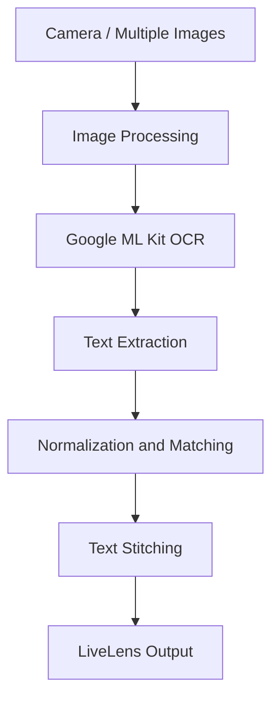

# LiveLens — Advanced Text & Code Scanner

<p align="center">
  
</p>

<p align="center">
  **Real-time OCR. Code extraction. Bulk image scanning.**
  <br />
  Built with Kotlin, Google ML Kit, CameraX and Jetpack Compose.
</p>

<p align="center">
  
  
  
  
</p>

---

## Screenshots

<p align="center">
  
  
  
</p>

## Features

- **Live OCR:** Continuous camera-based text recognition.
- **Code Extraction:** Recognizes programming text and symbols.
- **Smart Stitching:** Overlap detection and duplicate prevention while scrolling.
- **Bulk Image OCR:** Extract and combine text from multiple images.
- **OCR Controls:** Adjustable batch size, processing speed and text cleanup.
- **Export Formatting:** New line, empty line, `___`, `----` and image numbering.
- **Saved Snippets:** Save, copy, share and manage extracted text.
- **Glass Interface:** Full-screen camera with floating translucent controls.

## OCR Settings

<p align="center">
  
  
</p>

## How It Works



<details>
<summary><b>Technology Stack</b></summary>

| Technology | Usage |
|---|---|
| Kotlin | Android development |
| Jetpack Compose | UI |
| Material 3 | Design system |
| CameraX 1.5.0 | Camera and image analysis |
| Google ML Kit 16.0.1 | Text recognition |
| Kotlin Coroutines | Asynchronous processing |
| ViewModel | State management |

</details>

<details>
<summary><b>Performance and OCR Processing</b></summary>

- CameraX `STRATEGY_KEEP_ONLY_LATEST`.
- Single-flight OCR processing.
- Frame throttling and background execution.
- Direct `InputImage.fromMediaImage()` processing.
- Visual-line clustering and indentation reconstruction.
- Tail-anchored fuzzy overlap matching.
- Bounded bulk image processing concurrency.

</details>

<details>
<summary><b>Installation</b></summary>

**Requirements:** Android Studio, compatible JDK and Android SDK 36.

```bash
git clone https://github.com/KrupalWarale/LiveLens.git
```

Open the project in Android Studio, sync Gradle and run it on an Android device.

Build APK:

```bash
./gradlew assembleDebug
```

Windows:

```powershell
.\gradlew.bat assembleDebug
```

Camera permission is required for live OCR.

</details>


---

<p align="center">
  **LiveLens — See it. Scan it. Capture it.**
  <br />
  Developed by [Krupal Warale](https://github.com/KrupalWarale)
  · [LinkedIn](https://www.linkedin.com/in/krupal-warale/)
</p>
