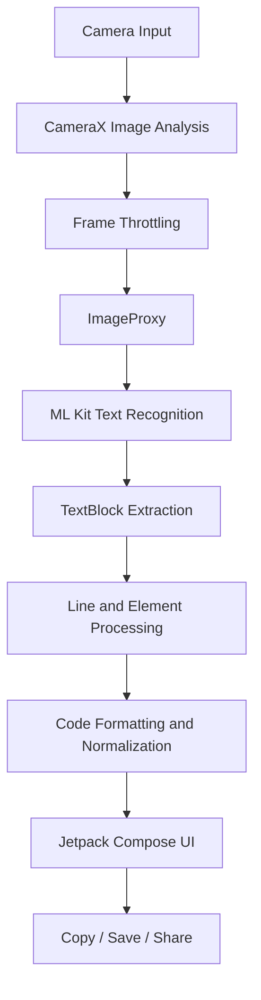

 # LiveLens — Advanced Live Text & Code Scanner

<p align="center">
  
</p>

<p align="center">
  <b>Turn your camera into a real-time text and code scanner.</b>
  <br />
  Powered by Google ML Kit, CameraX and Jetpack Compose.
</p>

<p align="center">
  
  
  
  
  
</p>

---

## ✨ Overview

**LiveLens** is an Android application designed for real-time text and programming-code extraction using your device's camera.

Point your camera at a laptop, monitor, book, or another phone, and LiveLens recognizes visible text directly on your device.

Built with a modern Android architecture, it combines on-device OCR, CameraX image analysis, and a full-screen floating glass interface.

## 📸 App Preview

<p align="center">
  
  
  
</p>

<p align="center">
  <i>Live Scanner · Extracted Code · Saved Snippets</i>
</p>

> Replace these image paths with your actual screenshots.

## 🚀 Features

| Feature | Description |
|---|---|
| 🔍 Real-time OCR | Extract text continuously through the camera |
| 💻 Code Recognition | Capture programming code, symbols and syntax |
| ⚡ On-device Processing | Google ML Kit text recognition |
| 🎯 Autofocus | Tap-to-focus and pinch-to-zoom |
| 🔦 Flash Control | Toggle camera torch instantly |
| 🪟 Floating Glass UI | Translucent, resizable extraction panel |
| 📋 Copy | Copy extracted text to clipboard |
| 💾 Save Snippets | Store extracted content locally |
| 📤 Share | Share text using Android's native share sheet |
| 📚 Snippet History | Browse, copy, share and delete saved snippets |

## 🖥️ Interface Design

### 1. Full-screen Scanner

<p align="center">
  
</p>

- Full-screen camera preview.
- Floating torch and scanning controls.
- Tap-to-focus and pinch-to-zoom.
- No unnecessary toolbars obstructing the camera.

### 2. Floating Extraction Panel

<p align="center">
  
</p>

- Adjustable frosted-glass container.
- Expandable and collapsible panel.
- Monospace font for programming code.
- Internal scrolling for longer extracted content.
- Quick Copy, Save, Share and Snippets actions.

### 3. Saved Snippets

<p align="center">
  
</p>

- Persistent local snippet storage.
- Reverse chronological ordering.
- Line counts and timestamps.
- One-tap copy and share.
- Individual deletion and Clear All functionality.

## ⚙️ How It Works

<p align="center">
  
</p>

### OCR Processing Pipeline



### Processing Flow

1. **Camera Input:** CameraX continuously provides camera frames.
2. **Frame Analysis:** Image analysis processes frames using a keep-only-latest backpressure strategy.
3. **OCR Recognition:** Google ML Kit detects text directly from camera images.
4. **Text Processing:** Recognized text is traversed through its block, line and element hierarchy.
5. **Output Rendering:** Jetpack Compose displays extracted text in a floating panel.
6. **User Actions:** Extracted content can be copied, saved or shared.

## 🛠️ Technology Stack

<p align="center">
  
</p>

| Technology | Purpose |
|---|---|
| Kotlin 2.2.x | Primary programming language |
| Jetpack Compose | Declarative UI |
| Material 3 | Modern Android design components |
| CameraX 1.5.0 | Camera preview and image analysis |
| Google ML Kit 16.0.1 | On-device text recognition |
| Kotlin Coroutines | Asynchronous processing |
| Accompanist Permissions 0.37.3 | Camera permission handling |
| Gradle Version Catalog | Centralized dependency management |

## ⚡ Performance Optimizations

LiveLens includes several optimizations designed to keep camera processing responsive.

### CameraX Frame Management

- `STRATEGY_KEEP_ONLY_LATEST` prevents an unnecessary backlog of camera frames.
- `AtomicBoolean` prevents concurrent OCR processing.
- A 200 ms frame throttle controls OCR frequency.
- Camera image buffers are released after processing.
- A reusable ML Kit recognizer avoids repeated initialization.

### Image Processing

- Direct `InputImage.fromMediaImage()` conversion.
- Avoids intermediate Bitmap allocations.
- Full HD analysis target: `1920 × 1080`.
- Tap-to-focus and pinch-to-zoom for closer text capture.

### Code-Oriented Text Processing

- Traverses the ML Kit `TextBlock → Line → Element` hierarchy.
- Preserves visual reading order.
- Uses line positioning and indentation information.
- Includes programming-symbol normalization for common OCR recognition errors.

## 🏗️ Project Modernization

LiveLens was modernized from an older Android project baseline.

| Component | Modernization |
|---|---|
| Kotlin | Updated to 2.2.x |
| Android Gradle Plugin | Updated to 9.1.x |
| Target SDK | 36 |
| CameraX | Updated to 1.5.0 |
| ML Kit | Updated to 16.0.1 |
| Compose | Migrated to Material 3 |
| Permissions | Updated Accompanist Permissions |
| Dependencies | Migrated to Gradle Version Catalog |

Unused template dependencies, including Room, Retrofit and Firebase-related dependencies, were commented out to simplify the project.

## 📂 Project Structure

```text
LiveLens/
│
├── app/
│   └── src/
│       └── main/
│           ├── java/
│           │   └── ...
│           │       ├── MainActivity.kt
│           │       ├── CameraScreen.kt
│           │       ├── MainScreen.kt
│           │       ├── TextRecognitionAnalyzer.kt
│           │       └── NoPermissionScreen.kt
│           │
│           ├── res/
│           │   ├── drawable/
│           │   ├── mipmap/
│           │   └── values/
│           │
│           └── AndroidManifest.xml
│
├── gradle/
│   └── libs.versions.toml
│
├── assets/
│   ├── livelens-banner.png
│   ├── architecture.png
│   └── screenshots/
│       ├── scanner-screen.png
│       ├── extracted-text.png
│       └── saved-snippets.png
│
├── build.gradle.kts
├── settings.gradle.kts
└── README.md
```

*The package-level structure may vary depending on the current source tree.*

## 🔧 Getting Started

### Prerequisites

- Android Studio (compatible with your configured AGP version).
- JDK compatible with your Gradle and AGP setup.
- Android device or emulator with camera support.
- Android SDK 36.

### Installation

**1. Clone the repository**

```bash
git clone https://github.com/KrupalWarale/LiveLens.git
```

**2. Open the project**

Open the cloned folder in Android Studio.

**3. Sync Gradle**

Allow Android Studio to download and synchronize dependencies.

**4. Run the application**

Connect an Android device, grant camera permission, and run the app.

Alternatively, build from the terminal:

```bash
./gradlew assembleDebug
```

For Windows:

```powershell
.\gradlew.bat assembleDebug
```

## 📱 Permissions

LiveLens requires camera access to perform real-time text recognition.

```xml
<uses-permission android:name="android.permission.CAMERA" />

<uses-feature
    android:name="android.hardware.camera"
    android:required="false" />
```

Camera permission is requested at runtime.

## 🗺️ Future Improvements

Potential areas for further development:

- Improved OCR accuracy for programming symbols.
- More reliable text overlap detection while scrolling.
- Adaptive OCR processing based on screen stability.
- Better preservation of blank lines and code indentation.
- Bulk image text extraction.
- Additional language recognition support.

## 👨‍💻 Author

**Krupal Warale**

<p align="left">
  <a href="https://github.com/KrupalWarale">
    
  </a>
  <a href="https://www.linkedin.com/in/krupal-warale/">
    
  </a>
</p>

## 📄 License

Add your preferred open-source license before distributing this project.

---

<p align="center">
  <b>LiveLens — See it. Scan it. Capture it.</b>
  <br />
  Built with Kotlin, CameraX, Google ML Kit and Jetpack Compose.
</p>
