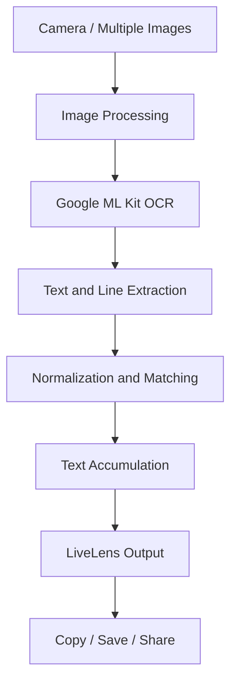

# LiveLens — Advanced Text & Code Scanner

<p align="center">
  
</p>

<p align="center">
  **Scan. Extract. Capture.**
  <br />
  Real-time text and code recognition with bulk image OCR.
</p>

<p align="center">
  
  
  
  
  
</p>

---

## Overview

**LiveLens** is an Android OCR application that extracts text and programming code directly from camera frames or multiple selected images.

Built with Google ML Kit, CameraX and Jetpack Compose, it provides continuous text recognition, scrolling-based text accumulation, bulk image extraction and a customizable OCR experience.

## Features

| Feature | Description |
|---|---|
| **Live OCR** | Continuously recognize text through the camera |
| **Code Extraction** | Extract programming code and common symbols |
| **Smart Text Stitching** | Detect overlapping content and prevent duplication while scrolling |
| **Bulk Image OCR** | Select multiple images and combine their extracted text |
| **Export Formatting** | Choose separators between extracted images |
| **OCR Settings** | Configure batch size, processing speed and text cleanup |
| **Glass UI** | Full-screen camera with floating translucent controls |
| **Saved Snippets** | Save, browse, copy and share extracted content |
| **Focus Controls** | Tap-to-focus, zoom and flash controls |

## Screenshots

### Live Scanner & Extracted Text

<p align="center">
  
  
</p>

### OCR Settings

<p align="center">
  
</p>

Configure OCR processing:

- Maximum Vote Cleanup
- Batch Size
- Fast Mode FPS
- Text processing and matching options

### Bulk Image OCR

<p align="center">
  
  
</p>

Extract text from multiple images and combine the results into one output.

Available separators:

- New line
- Empty line
- Three underscores (`___`)
- Four dashes (`----`)
- Image numbering

## How It Works



## Tech Stack

- **Language:** Kotlin
- **UI:** Jetpack Compose, Material 3
- **Camera:** CameraX 1.5.0
- **OCR:** Google ML Kit Text Recognition
- **Concurrency:** Kotlin Coroutines
- **Architecture:** ViewModel and Repository pattern

## Getting Started

**Requirements:** Android Studio, compatible JDK, Android SDK 36 and an Android device.

```bash
git clone https://github.com/KrupalWarale/LiveLens.git
```

Open the project in Android Studio, sync Gradle and run the application.

Build using:

```bash
./gradlew assembleDebug
```

Windows:

```powershell
.\gradlew.bat assembleDebug
```

Camera permission is required for live scanning.

## Author

**Krupal Warale**

[GitHub](https://github.com/KrupalWarale) · [LinkedIn](https://www.linkedin.com/in/krupal-warale/)

---

<p align="center">
  **LiveLens — See it. Scan it. Capture it.**
</p>
